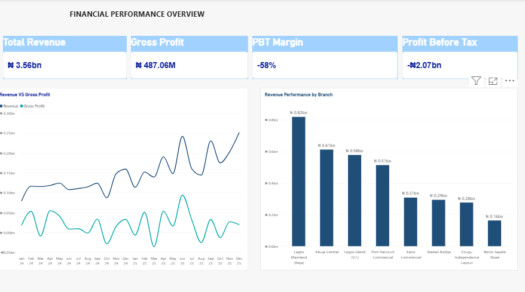

# Financial Performance Dashboard

## Project Overview

This project focuses on analysing an organisation's financial performance using Microsoft Power BI. The dashboard provides insights into revenue, expenses, profitability, and departmental performance.

## Project Objectives

- Analyse monthly financial performance.

- Compare financial results for 2024 and 2025.

- Identify major expense drivers.

- Evaluate departmental cost efficiency.

- Provide insights to support management decision-making.

## Tools and Technologies

- Microsoft Power BI

- Power Query

- DAX (Data Analysis Expressions)

- Microsoft Excel

## Key Performance Indicators (KPIs)

- Revenue

- Gross Profit

- Operating Expenses

- Profit Before Tax (PBT)

- PBT Margin

## Analysis Performed

- Monthly financial performance analysis.

- Year-on-year financial comparison.

- Departmental expense analysis.

- Profitability and expense trend analysis.

## Key Insights

- The financial analysis revealed the following:

- The organisation recorded total revenue of approximately ₦3.56 billion.

- Gross Profit stood at approximately ₦487.06 million.

- Profit Before Tax (PBT) was approximately -₦2.07 billion.

- The PBT margin was approximately -58%, indicating an overall loss position.

- Cost of Sales increased from ₦1.17 billion in 2024 to ₦1.90 billion in 2025.

- Logistics & Fleet recorded a significant increase in departmental expenses between 2024 and 2025.

## Recommendations

- Based on the findings, the following actions are recommended:

- Review the major drivers of Cost of Sales.

- Strengthen expense monitoring and cost-control measures.

- Investigate the increase in Logistics & Fleet expenses.

- Monitor profitability and departmental performance regularly.

- Use financial insights to support strategic management decisions.

## Project Author

Data Analytics Portfolio Project

## Dashboard Preview

## How to View This Project

- View the dashboard screenshot above for a quick preview.
- [Download the Power BI Dashboard](FinSight_Recovery.pbix) to explore the interactive report.
- Open the PBIX file using Microsoft Power BI Desktop.

## Project Note

This project uses sample financial data for learning and demonstration purposes.

## Repository Structure

DSA-Project/
│
├── README.md
├── Financial_Performance_Dashboard.png
└── FinSight_Recovery.pbix

### File Descriptions

- `README.md` – Project overview, objectives, key findings, and recommendations.
- `Financial_Performance_Dashboard.png` – Screenshot preview of the Power BI dashboard.
- `FinSight_Recovery.pbix` – Interactive Power BI report file.

- ## How to Explore the Dashboard

The dashboard includes interactive filters that allow users to explore financial performance from different perspectives:

- **Year:** Compare financial performance between 2024 and 2025.
- **Branch:** Examine financial results across different branches.
- **Department:** Compare expenses and performance across departments.
- **Transaction Status:** Filter transactions by their status.

These filters help users investigate revenue, profitability, and operating expenses in greater detail.

## Business Questions Explored

This project uses financial data to investigate the following questions:

1. How did revenue and profitability change between 2024 and 2025?
2. What happened to operating expenses and profit margins?
3. Which departments recorded higher or lower expenses?
4. How did financial performance differ across branches?
5. Which areas may require management attention?

 ## Project Status

**Status:** Completed

This project demonstrates practical skills in:
- Microsoft Power BI
- Power Query for data transformation
- DAX for financial calculations
- Data visualisation and reporting
- Financial performance analysis

