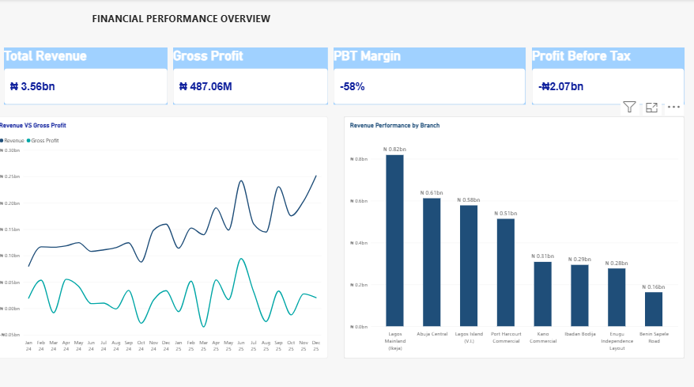

# Financial Performance Dashboard

## Project Overview

This project focuses on analysing an organisation's financial performance using Microsoft Power BI. The dashboard provides insights into revenue, expenses, profitability, and departmental performance.

## Project Objectives

- Analyse monthly financial performance.

- Compare financial results for 2024 and 2025.

- Identify major expense drivers.

- Evaluate departmental cost efficiency.

- Provide insights to support management decision-making.

## Tools and Technologies

- Microsoft Power BI

- Power Query

- DAX (Data Analysis Expressions)

- Microsoft Excel

## Key Performance Indicators (KPIs)

- Revenue

- Gross Profit

- Operating Expenses

- Profit Before Tax (PBT)

- PBT Margin

## Analysis Performed

- Monthly financial performance analysis.

- Year-on-year financial comparison.

- Departmental expense analysis.

- Profitability and expense trend analysis.

## Key Insights

This section will highlight the major findings from the financial analysis, including changes in profitability, expense patterns, and departmental performance.

## Recommendations

Recommendations will be provided based on the findings to support better financial planning, cost management, and business performance.

## Project Author

Data Analytics Portfolio Project

## Dashboard Preview

